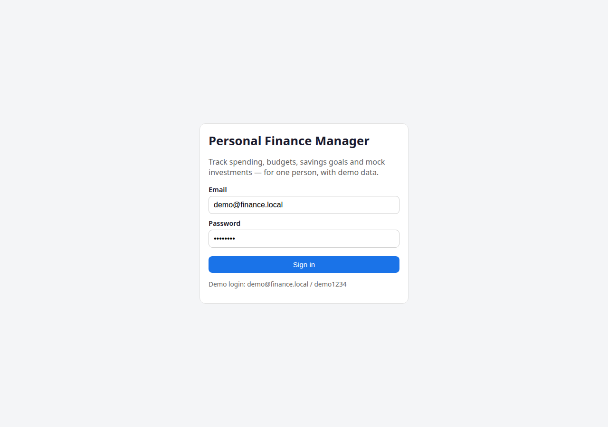
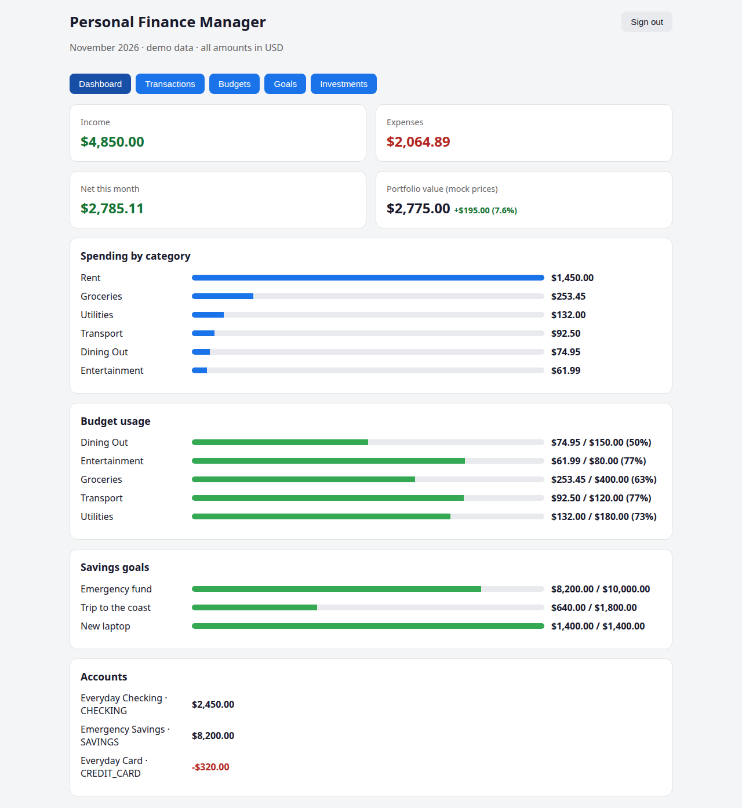
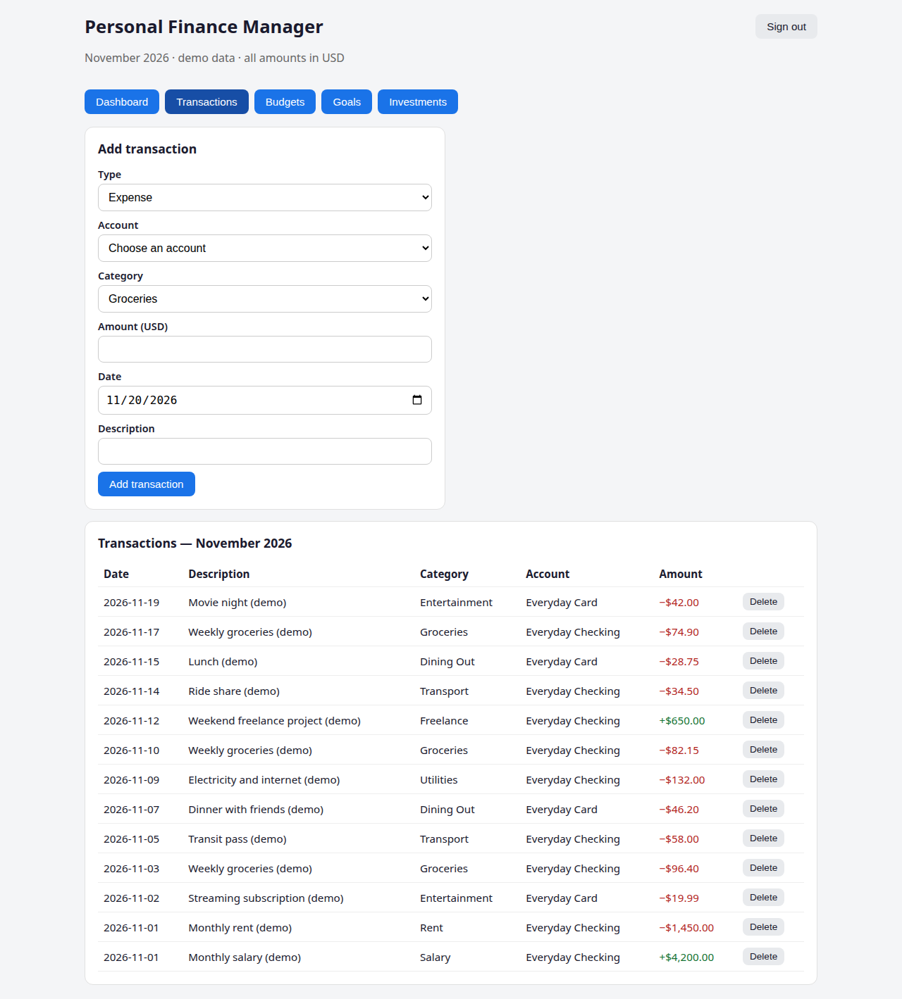
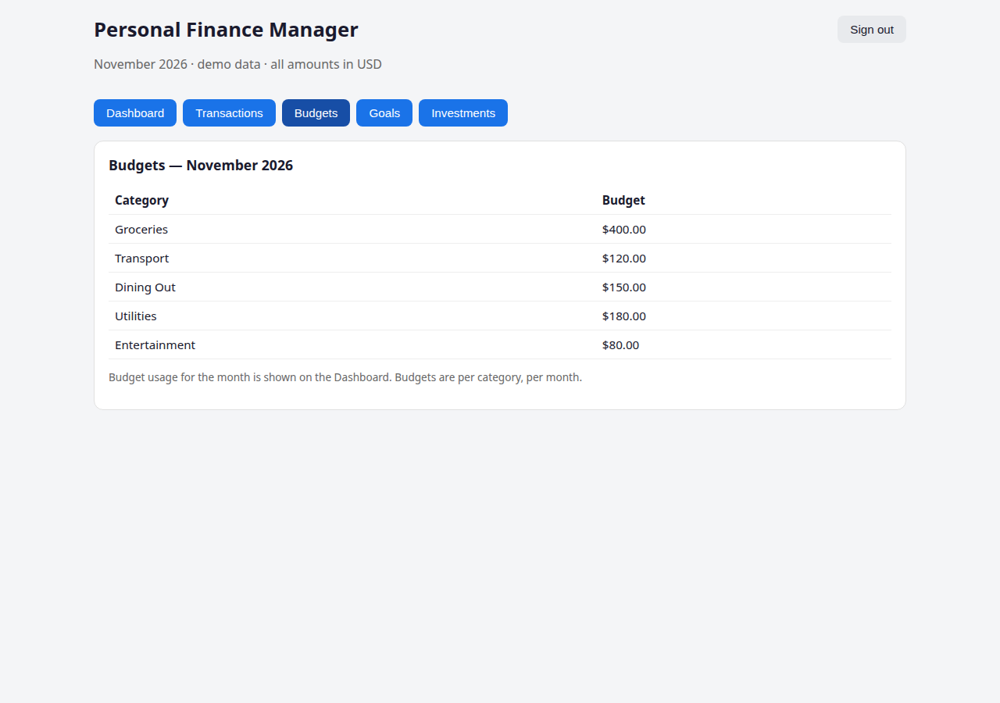
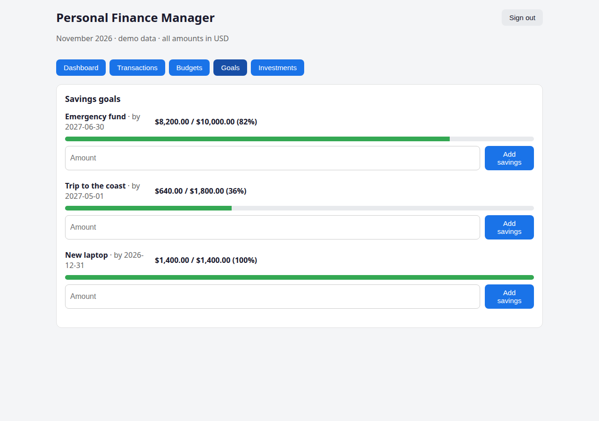
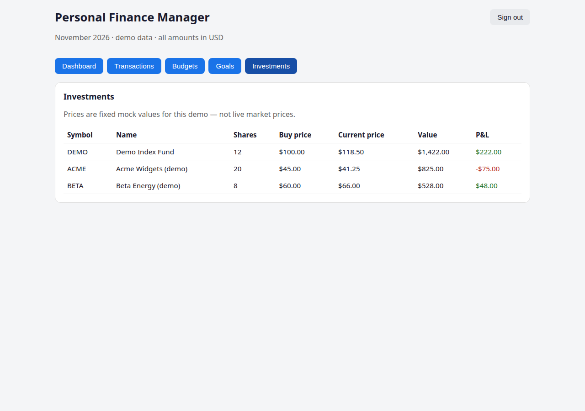

# Personal Finance Manager

I built this to practice a full-stack flow end to end: a Spring Boot backend, a React frontend, and a database in between. It tracks one person's money for a month: income and spending, budgets per category, savings goals, and a few mock investments. Nothing here is real. The data is made up, the prices are fixed mock values, and it is not connected to any bank or employer.

## What it does

- Dashboard: income, expenses, net for the month, spending by category, budget usage, goal progress, and portfolio totals.
- Transactions: add and delete income/expense entries. Adding one updates the account balance.
- Budgets: one monthly budget per spending category, with spent vs budget and what is left.
- Savings goals: progress toward a target, capped at 100%, and you can add contributions.
- Investments: holdings with shares, buy price, and a mock current price, so profit/loss is calculated, never fetched live.
- Login: one demo user with a JWT. Every `/api/**` endpoint except login needs the token.

## Screenshots













## How I built it

Backend first: JPA entities and repositories, then the service layer that does the monthly math (totals, spending by category, budget usage, goal percentages, portfolio profit/loss). The controllers are thin and the service holds the logic, which made it easy to unit test with mocked repositories.

One bug I actually hit while testing: budget usage grouped transactions by category id, and that crashed with a null key when a category had no id yet. I changed it to group by category name and to skip transactions with no category. The tests for that are in `FinanceServiceTest`.

Security is simple on purpose: Spring Security with a JWT filter, one demo user in config, BCrypt for the demo password, stateless sessions. The frontend is Vite + React + TypeScript, no component libraries, plain CSS. API calls go through the Vite proxy to the backend in development.

## Tech stack

- Backend: Java 21, Spring Boot 3, Spring Web, Spring Data JPA, Spring Security (JWT), Bean Validation, H2 in-memory database, JUnit 5 + Mockito.
- Frontend: Vite, React 18, TypeScript.
- Data: `schema.sql` + `data.sql` seed a demo month (November 2026) on startup. The database resets when the backend restarts.

## How to run

Backend (port 8080):

```bash
cd backend
mvn spring-boot:run
```

Frontend (port 5173):

```bash
cd frontend
npm install
npm run dev
```

Demo login: `demo@finance.local` / `demo1234`. The demo JWT secret and demo password live in `application.properties` and are demo-only. Do not reuse them anywhere real.

## Tests

```bash
cd backend
mvn test
```

6 tests: finance service calculations and JWT creation/validation.
